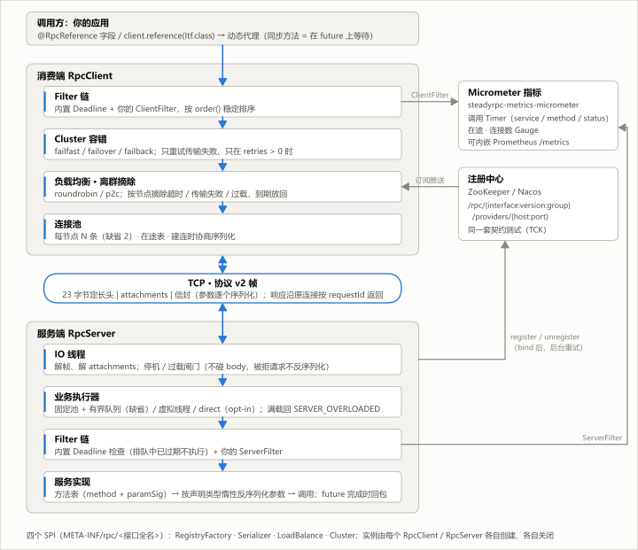
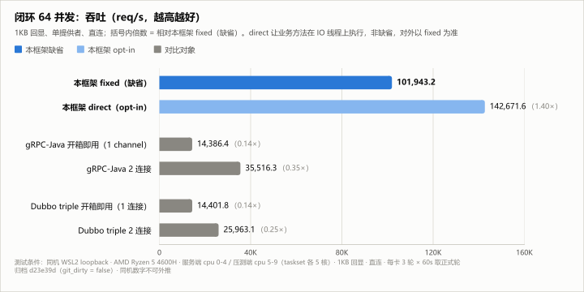
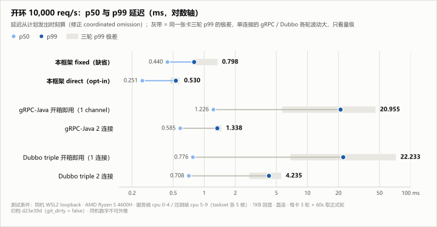
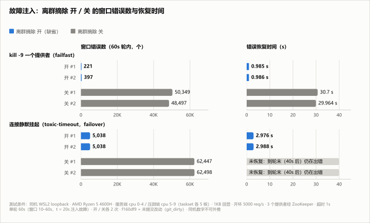

# rpc-framework

[](https://github.com/sisyfy-Zhang/rpc-framework/actions/workflows/ci.yml) [](https://github.com/sisyfy-Zhang/rpc-framework/actions/workflows/codeql.yml) [](https://scorecard.dev/viewer/?uri=github.com/sisyfy-Zhang/rpc-framework) [](https://codecov.io/gh/sisyfy-Zhang/rpc-framework) [](https://central.sonatype.com/artifact/io.github.sisyfy-zhang/rpc-core) [](https://javadoc.io/doc/io.github.sisyfy-zhang/rpc-core) [](LICENSE) 

[简体中文](README.md) | English

A Java RPC library you can depend on in a real project: Netty transport, a custom binary protocol (v2), ZooKeeper / Nacos discovery and a Spring Boot 4 starter, with archived benchmark and fault-injection evidence. The core is plain Java with no container dependency; `1.0.0` is on Maven Central (`io.github.sisyfy-zhang`, Java packages `com.feynman.rpc.*`).



## Features

- **Protocol & methods**: plain-Java `RpcClient` / `RpcServer` instances with immutable config and no global state; protocol v2 (23-byte header + framework-encoded attachments and envelope); multiple parameters, overloads, generics, `interface + version + group`; Protostuff (default; schemas built from declared generic types, class-name allowlist for polymorphic fields) and fastjson2, negotiated per connection; business exceptions restored by type.
- **Discovery & resilience**: ZooKeeper and Nacos behind one 14-case contract test suite (TCK); `roundrobin` / `p2c`; `failfast` / `failover` / `failback` that only retry transport failures; a per-call deadline budget propagated downstream; graceful shutdown; per-node outlier ejection (on `main`, enabled by default).
- **Performance & backpressure**: `fixed` / `virtual` / opt-in `direct` executors that reject with `SERVER_OVERLOADED` when full; flush consolidation; outbound backpressure; ByteBufs allocated only on event loops.
- **Observability & Boot**: one `Filter` interface for both sides, attachments via `RpcContext`; Micrometer timers and gauges with an embeddable Prometheus `/metrics` endpoint and a Grafana dashboard. **Spring Boot 4 starter**: `@RpcService` / `@RpcReference`, `rpc.*` properties with IDE metadata, non-blocking `SmartLifecycle` start and async shutdown, optional Actuator health indicator.

## Quick Start

```xml
<dependencyManagement><dependencies><dependency>
  <groupId>io.github.sisyfy-zhang</groupId><artifactId>rpc-bom</artifactId>
  <version>1.0.0</version><type>pom</type><scope>import</scope>
</dependency></dependencies></dependencyManagement>
<dependencies>
  <dependency><groupId>io.github.sisyfy-zhang</groupId><artifactId>rpc-spring-boot-starter</artifactId></dependency>
  <dependency><groupId>io.github.sisyfy-zhang</groupId><artifactId>rpc-registry-zookeeper</artifactId></dependency>
  <dependency><groupId>io.github.sisyfy-zhang</groupId><artifactId>rpc-serialize-protobuf</artifactId></dependency>
</dependencies>
```

For plain Java use `rpc-core` instead of the starter; add `rpc-serialize-fastjson2` to negotiate a second format. The BOM manages the versions of the framework modules and ZooKeeper; it does not override Netty, Jackson, Spring or other third-party versions. Shared interface (DTOs must be plain classes, not records: Protostuff doesn't support them), provider, and consumer, copied verbatim from [`rpc-examples`](rpc-examples/README.md):

```java
public interface UserFacade {

	User saveUser(User user);

	void saveUsers(List<User> users);
}
```

```java
@RpcService
public class UserFacadeImpl implements UserFacade {
```

```java
@Component
public class UserGateway {

	@RpcReference(timeout = 5000)
	private UserFacade userFacade;

	public User register(int id, String name) {
		return userFacade.saveUser(new User(id, name));
	}
}
```

The registry defaults to ZooKeeper at `localhost:2181` (`rpc.registry.address`). Full walkthrough and the plain-Java builder version: [getting-started (Chinese)](docs/getting-started.md).

## Performance & Evidence

Numbers come only from the benchmark pipeline; the charts are generated from archived result JSON by [`bench/bin/charts.py`](bench/bin/charts.py) (per-number sources: [docs/images/](docs/images/README.md)).



Closed loop, 64 in flight: this framework (default `fixed` executor) 101,943.2 req/s; gRPC-Java / Dubbo triple out of the box 14,386.4 / 14,401.8, with 2 connections 35,516.3 / 25,963.1.



Open loop at 10,000 req/s (latency from the scheduled send time): p99 0.798 ms vs 20.955 / 22.233 ms (gRPC / Dubbo out of the box) and 1.338 / 4.235 ms (2 connections).

<sub>Both charts: single-host WSL2 loopback, AMD Ryzen 5 4600H, server on cpu 0-4 / load generator on cpu 5-9, 1 KB echo, direct connection, 3 rounds × 60 s per card, clean commit d23e39d. Single-host loopback, not extrapolable.</sub>



With outlier ejection on, errors after `kill -9` (failfast) drop from 50,349 / 48,497 to 221 / 397, and a silently hung connection (failover) goes from 62,447 / 62,498 unrecovered timeouts to 5,038 / 5,038 with recovery in about 3 s.
<sub>Open loop 5,000 req/s, 3 providers via ZooKeeper, 1 s timeout, 2 runs each; single-host loopback, not extrapolable; probe-grade (git_dirty), see [probes/outlier-detection.md (Chinese)](docs/probes/outlier-detection.md).</sub>

Correctness is backed by cross-module integration tests (including a real SIGTERM on Linux), a registry contract test suite (TCK), ArchUnit rules with self-tests that prove they can fail, jqwik codec fuzzing, per-test-class thread and in-flight leak assertions, Netty paranoid leak detection and JaCoCo (rpc-core line coverage ≥ 70%); see [CONTRIBUTING.md (Chinese)](CONTRIBUTING.md#测试体系).

## Docs

[Getting started](docs/getting-started.md) · [Configuration](docs/configuration.md) · [Protocol v2](docs/protocol.md) · [Observability](docs/observability.md) · [Benchmarking](docs/benchmarking.md) · [Comparison](docs/comparison.md) — all in Chinese.
Archives: official [bench/reports/20261022-d23e39d/](bench/reports/20261022-d23e39d/) (clean commit) · probes [bench/reports/probes/](bench/reports/probes/README.md) (git_dirty, not official).
Contributing: [CONTRIBUTING.md](CONTRIBUTING.md) (Chinese) · Security: [SECURITY.md](SECURITY.md) (private vulnerability reporting is enabled) · [Issues](https://github.com/sisyfy-Zhang/rpc-framework/issues).

## License

MIT, see [LICENSE](LICENSE). `AllowlistIdStrategy.java` in `rpc-serialize-protobuf` is derived from Protostuff 1.8.0 and stays under Apache 2.0 ([NOTICE](NOTICE), [licenses/Apache-2.0.txt](licenses/Apache-2.0.txt)).
